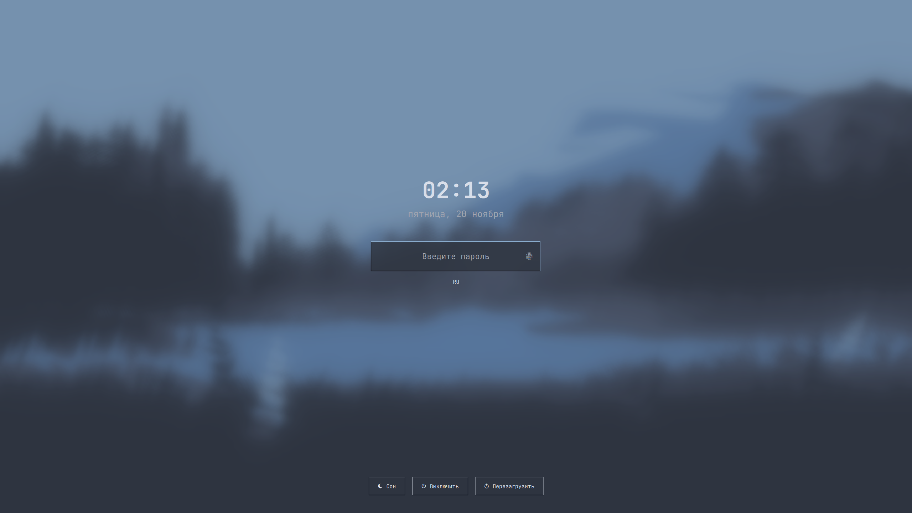

# Better Than Better Lock - jmihbay fork of [Better Lock](https://github.com/BibekBhusal0/omarchy-better-lock)

Personal [Omarchy](https://github.com/omacom/omarchy) lock screen, forked from [BibekBhusal0/omarchy-better-lock](https://github.com/BibekBhusal0/omarchy-better-lock).
Plugin ID: `jmihbay.better-lock`. Original MIT license and authorship are preserved.

This fork builds on the excellent Better Lock by making its Omarchy lock screen easier to customize. Use the optional [configuration file](#configuration) to choose the interface language, adjust the wallpaper and sleep timers, and decide which controls to show. The plugin works out of the box with its defaults. An AI agent can help tailor the settings using the [agent guide](AGENTS.md). Your preferences live outside the plugin checkout, so they carry over when you update through Omarchy.



## What changed

- Current physical keyboard layout below the password field (EN/RU).
- Caps Lock warning appears only while Caps Lock is on.
- Current Omarchy wallpaper, with softer configurable blur and only 15% theme-colored dimming.
- Media player hidden by default, including its keyboard navigation targets.
- Colors/fonts follow Omarchy. Password and fingerprint authentication flows are unchanged.

The lock remains opaque: transparency here means less tint over the wallpaper, never exposing applications behind the lock.

## Install

Only one lock plugin should be enabled. Disable your existing custom lock, then:

```sh
omarchy plugin add https://github.com/jmihbay/omarchy-better-than-better-lock.git --enable --yes
omarchy-shell lock preview
omarchy-shell lock hidePreview
```

Preview is not a real lock. Test actual password/fingerprint unlocking yourself before relying on it.

## Installing with an AI agent

This repository includes an [AGENTS.md](AGENTS.md) guide for agents helping with
installation, configuration and development. Ask your agent to read it before
installing. It explains which settings to offer immediately, how to preserve your
existing configuration, and how to check the appearance in preview and roll back.
Agents that do not automatically discover `AGENTS.md` can read it explicitly.

## Configuration

Optional `~/.config/omarchy/better-lock.json` (see `config.example.json`):

```json
{
  "language": "auto",
  "timeFormat": "HH:mm",
  "dateFormat": "dddd, d MMMM",
  "showKeyboardLayout": true,
  "showCapsLock": true,
  "showMedia": false,
  "showForgotPassword": true,
  "screenOffSeconds": 15,
  "suspendSeconds": 45,
  "forgotPasswordScreenOffSeconds": 3.5,
  "allowFingerprint": true,
  "backgroundDim": 0.15,
  "backgroundBlur": 0.65,
  "backgroundBlurMax": 64,
  "backgroundBlurMultiplier": 1.0
}
```

Set `language` to `"auto"` (default) to follow Omarchy, or use `"en"` or `"ru"` to override the lock screen language. Unsupported codes follow Omarchy. This setting does not change the keyboard layout. Plugin-specific strings are available in English and Russian, with English as the fallback. Date and time use the selected locale and your configured format.

Set `allowFingerprint` to `false` for password-only unlock in this plugin. This hides the fingerprint indicator and stops fingerprint discovery and authentication.

Set `showForgotPassword` to `false` to hide the button and remove it from keyboard navigation. Disabling it also clears its message and cancels a pending screen-blank timer. It is shown by default for compatibility.

`screenOffSeconds` blanks the display after locked inactivity. `suspendSeconds`
suspends the computer after locked inactivity, independently of display blanking.
Both count from the last activity, or from locking if there was none.
`forgotPasswordScreenOffSeconds` controls the separate delay after pressing
Forgot password. All three are in seconds. Set any of them to `0` to disable that
timer. The Sleep button still suspends immediately.

The file is re-read every 10 seconds, without restarting the shell. File values take precedence over plugin settings. Numeric settings are validated and clamped: dim/blur 0–1, blurMax 0–128, multiplier 0–2. Lower `backgroundDim` shows more wallpaper; lower `backgroundBlur` reveals more detail. The upstream `lock.json` is not used by this fork.

Keyboard state is refreshed on layout events and once per second only while the lock or preview is visible. Queries have a two-second deadline and a 64 KiB output limit. No network access is used. Caps Lock state comes from Hyprland, not a guessed toggle counter.

## Development and updates

```sh
node --test tests/*.test.cjs
omarchy plugin validate .
```

`origin` is our fork; `upstream` is the original repository. Installed copies update from our fork with `omarchy plugin update jmihbay.better-lock`. Upstream changes are reviewed and merged in this development checkout before pushing to our fork; conflicts are resolved here. Local configuration remains outside the repository.

To restore your previous lock, disable this plugin and enable the lock ID you recorded before installation. For the built-in Omarchy lock:

```sh
omarchy plugin disable jmihbay.better-lock
omarchy plugin enable omarchy.lock
```

## Credits

Omarchy's original session lock, Bibek Bhusal's Better Lock interface, and our keyboard indicator and appearance settings. See `LICENSE`.
